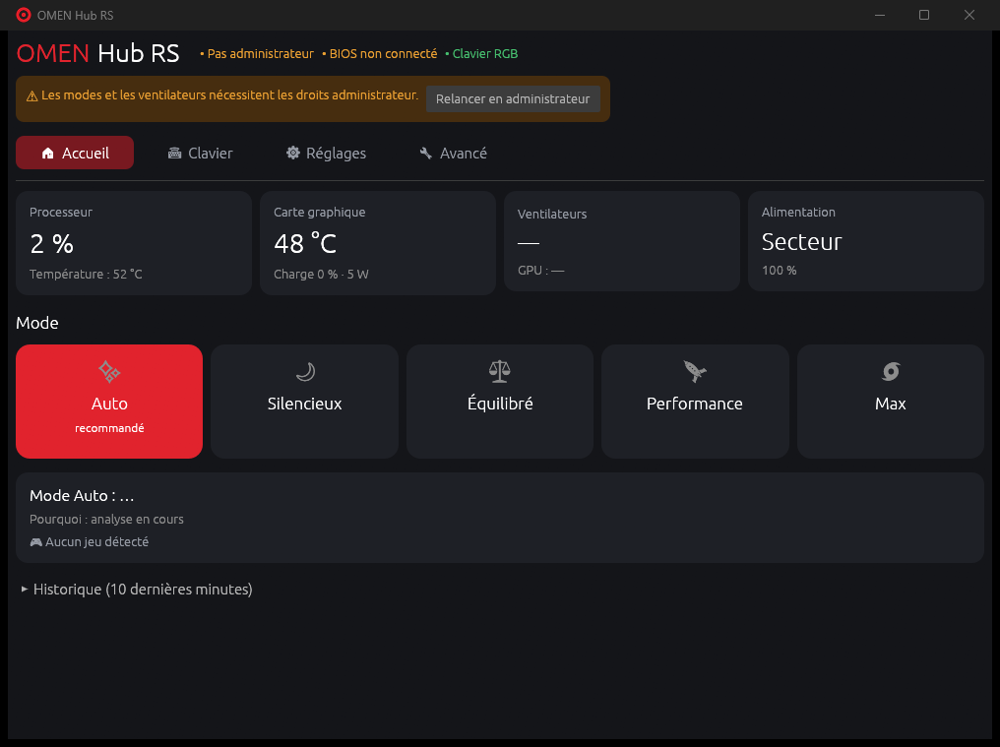

# OMEN Hub RS

Remplaçant simple et open-source des réglages de l'**OMEN Gaming Hub** pour les PC
portables HP OMEN : modes de performance avec **mode Auto**, ventilateurs, **clavier RGB**,
lancement au démarrage. Écrit en Rust, développé et testé sur un OMEN 17-cm2xxx
(carte 8BB0, BIOS F.10, RTX 4070 Laptop, i7-13700HX).



## Ce que fait l'application

| | |
|---|---|
| **Modes** | Un clic : **Auto** (recommandé), **Silencieux**, **Équilibré**, **Performance**, **Max** (ventilateurs à fond). |
| **Mode Auto** | Comme le Hub : jeu lancé ou PC très sollicité → Performance ; trop chaud → ventilateurs au max ; PC au repos → Silencieux. Monte vite, redescend lentement (pas d'effet yo-yo). |
| **Ventilateurs** | Vitesses en tr/min, mode Max, courbe personnalisée, vitesse fixe. |
| **Clavier RGB** | Couleur unie (9 couleurs + nuancier), 9 effets animés (vague, respiration, cycle…), thèmes ou vos couleurs, extinction, éclairage d'usine. |
| **Surveillance** | Charge CPU/GPU, températures (GPU NVIDIA, zone thermique, capteurs du BIOS), vitesses ventilateurs, alimentation, historique 10 min. |
| **Démarrage** | Option « Lancer au démarrage de Windows » (sans fenêtre UAC à chaque démarrage), démarrage réduit près de l'horloge, la croix garde l'appli en arrière-plan. |

## Installer

```powershell
.\cargo-vs.cmd build --release     # compile (Visual Studio Build Tools requis)
.\install.ps1                      # copie dans %LOCALAPPDATA%\Programs\OMEN Hub RS + raccourcis
```

Puis double-cliquez sur **OMEN Hub RS** (Bureau ou menu Démarrer). Windows demande
l'autorisation administrateur : c'est normal, l'interface BIOS de HP l'exige (comme
l'application officielle). Pour le lancement automatique : onglet **Réglages** →
« Lancer OMEN Hub RS au démarrage de Windows ».

> Fermez l'OMEN Gaming Hub (et son icône) pendant l'utilisation : les deux applications
> écrivent les mêmes réglages et la dernière qui écrit gagne. L'application vous prévient
> si le Hub est ouvert.

Désinstaller : `.\install.ps1 -Uninstall` (décochez d'abord le lancement au démarrage).

## Ligne de commande

```powershell
omen                          # ouvre la fenêtre
omen mode performance         # silencieux | equilibre | performance | max   (admin)
omen sensors                  # capteurs (la partie BIOS demande l'admin)
omen fans                     # vitesses ventilateurs                        (admin)
omen max-fan on|off           # ventilateurs à fond                          (admin)
omen kbd-set rouge            # clavier : couleur (nom ou RRGGBB) --intensite 60
omen kbd-effect vague         # respiration, cycle, onde, pluie... --vitesse 2 --couleurs rouge,bleu
omen kbd-off | kbd-reset | kbd-info
omen autostart on|off|status
omen --help                   # tout le reste (gpu-mode, fan-table, raw...)
```

Les commandes BIOS lancées sans droits proposent d'elles-mêmes une relance en administrateur.

## Comment ça marche

```
crates/omen-wmi   Interface BIOS HP (WMI root\WMI hpqBIntM) : modes, ventilateurs, GPU, capteurs, MUX
crates/omen-kbd   Clavier RGB en HID direct (contrôleur USB 0461:4E9A, interface MI_02)
crates/omen-core  Modes, mode Auto, capteurs (PDH/NVML), détection de jeux, réglages, démarrage auto
crates/omen-gui   Fenêtre (egui) + icône de notification       → omen-hub.exe
crates/omen-cli   Ligne de commande                              → omen.exe
```

Détails techniques, protocoles et état des vérifications : [docs/IMPLEMENTATION.md](docs/IMPLEMENTATION.md).
Rétro-ingénierie complète du Hub : [docs/omen-hub/](docs/omen-hub/README.md).

Tout passe par les interfaces prévues par HP : l'interface WMI du BIOS et le
périphérique HID du clavier. Aucun pilote noyau, aucun accès MSR/PCI : le pilote
`HpReadHWData` de HP est volontairement hors périmètre.

## Crédits et licence

Implémentation originale (MIT). Les faits de protocole (codes de commande, formats de
trames) ont été établis par analyse de l'application installée sur ce matériel
(ilspycmd, Ghidra, REA) et par vérification en direct, avec les notes publiques
d'[OmenMon](https://github.com/OmenMon/OmenMon) comme référence factuelle. Aucun code
propriétaire n'est inclus.
